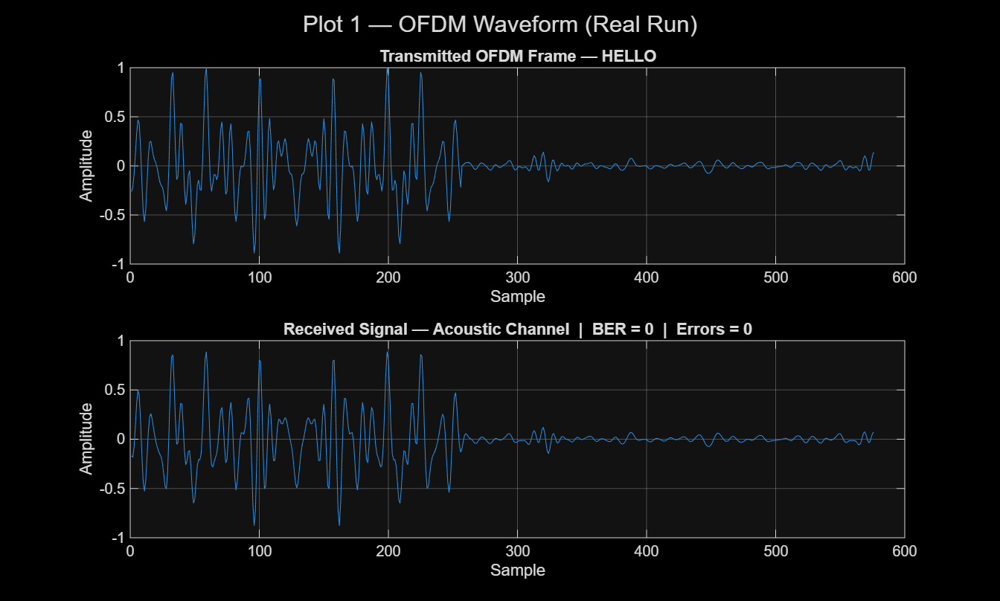
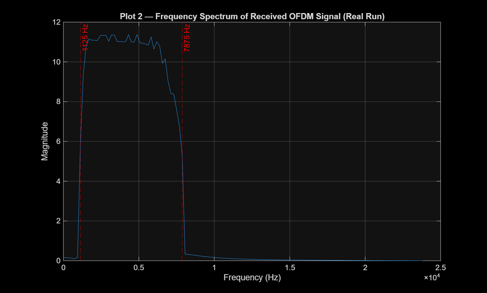
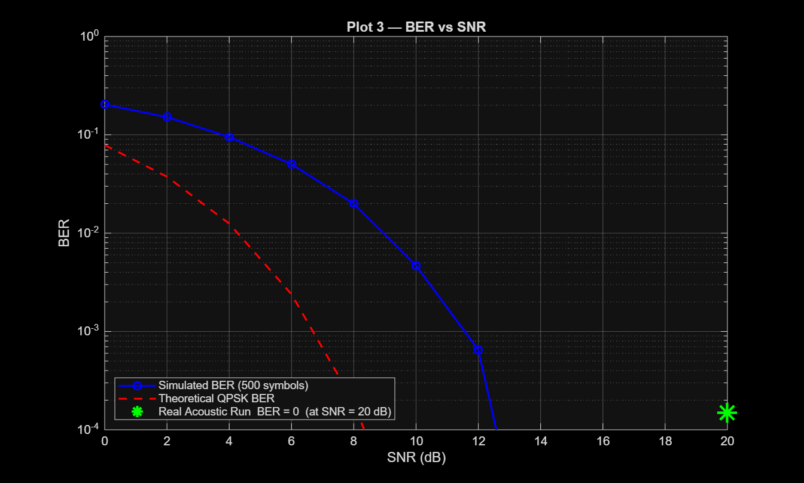
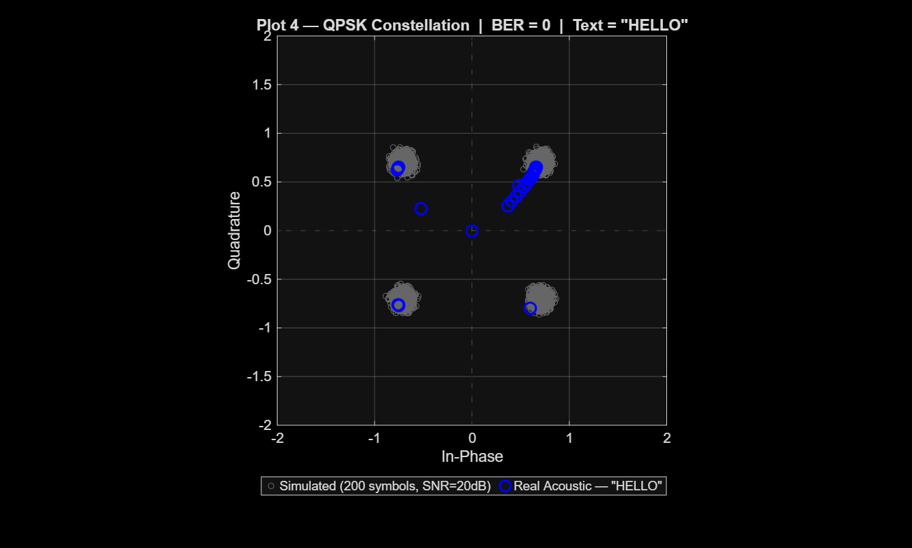

# Acoustic OFDM Communication System

> A MATLAB reference implementation of a **real-valued, audio-band OFDM** link for short text messages. The project demonstrates text-to-bits framing, π/4-offset QPSK, Hermitian subcarrier mapping, cyclic-prefix protection, preamble-based frame synchronization, and text recovery from a recorded waveform.

[](https://www.mathworks.com/products/matlab.html)
[](#system-parameters)
[](#system-parameters)

## Overview

This repository is an academic OFDM demonstration designed for the audible band. A text payload is converted into bits, placed on 37 positive-frequency QPSK subcarriers, and mirrored onto their negative-frequency partners. The Hermitian mapping makes the inverse FFT waveform real-valued, so it can be stored, played, and recorded as ordinary mono audio.

The receiver resamples the recording to 48 kHz, applies a band-pass filter, finds the frame with a known preamble, removes the cyclic prefix (CP), takes an FFT, demodulates QPSK symbols, and converts the recovered bit stream back to text.

The repository includes two transmission paths:

- **Direct WAV loopback** (`TX/main_tx.m`) writes a normalized frame to `recording.wav` for repeatable, device-free verification.
- **Speaker playback** (`TX/main_tx_acoustic.m`) plays the frame through an audio output; an externally captured recording can then be decoded by `RX/main_rx.m`.

> **Research scope.** This is a compact instructional/research prototype, not a production acoustic modem. It does not yet include an in-band length header, channel estimation/equalization, carrier/sample-rate-offset correction, forward-error correction, CRC, or robust packet detection. See [Interpretation and limitations](#interpretation-and-limitations) before treating the supplied result as a general acoustic-link performance claim.

---

## System architecture

```text
                         TRANSMITTER
 Text message
     │
     ▼
  8-bit character serialization ──► zero padding to 74-bit OFDM blocks
     │
     ▼
 π/4-offset QPSK (2 bits/subcarrier)
     │
     ▼
 Positive bins 7:43 + conjugate mirror bins ──► 256-point real IFFT
     │                                             (Hermitian symmetry)
     ▼
 64-sample cyclic prefix ──► known 256-sample preamble + OFDM data
     │
     ├──► `recording.wav` direct loopback
     └──► speaker playback / external audio recording
                                      │
                                      ▼
                                  RECEIVER
  48 kHz resampling ─► 1.125–7.875 kHz band-pass filter
                                      │
                                      ▼
           matched preamble correlation / frame-start estimate
                                      │
                                      ▼
          CP removal ─► FFT ─► active-bin extraction ─► π/4 QPSK demodulation
                                      │
                                      ▼
                         bit truncation to payload length ─► text
```

### Signal model

For each OFDM data symbol, QPSK values are written to MATLAB bins `active_idx = 7:43`, which are zero-indexed frequency bins \(k=6,\ldots,42\). Their conjugates are placed at `N_fft - active_idx + 2`. With DC and the Nyquist bin left at zero,

\[
X[N-k] = X[k]^*, \qquad x[n] = \operatorname{IFFT}\{X[k]\}\in\mathbb{R}.
\]

The positive-frequency bins occupy 1.125–7.875 kHz at a 48 kHz sample rate. The same Hermitian construction is used for the deterministic BPSK preamble.

---

## System parameters

| Parameter | Value | Notes |
|---|---:|---|
| Sampling rate, \(F_s\) | 48,000 Hz | Audio I/O and receiver resampling target |
| FFT size, \(N_{\rm FFT}\) | 256 samples | Subcarrier spacing = **187.5 Hz** |
| Cyclic prefix, \(N_{\rm CP}\) | 64 samples | 1.333 ms guard interval |
| Useful symbol duration | 5.333 ms | \(256 / 48000\) |
| Total OFDM-symbol duration | 6.667 ms | \((256+64) / 48000\) |
| Active positive-frequency bins | MATLAB `7:43` | Zero-indexed \(k=6\ldots42\) |
| Occupied positive-frequency band | 1.125–7.875 kHz | 37 active data subcarriers |
| Modulation | QPSK, \(M=4\), phase offset \(\pi/4\) | 2 bits per active subcarrier |
| Payload per OFDM symbol | 74 bits | \(37\times\log_2 4\) |
| Nominal payload rate | 11.1 kbit/s | Before preamble, padding, and application framing overhead |
| Preamble | 256 samples, BPSK/Hermitian | Fixed seed (`rng(42)`) for repeatability |
| CP delay-spread budget | ≤ 64 samples / 1.333 ms | Provided synchronization error also lies within the CP |

The 64-sample CP protects a correctly aligned FFT window against channel impulse-response spread up to 1.333 ms. It is a guard interval—not a substitute for channel estimation or timing/frequency tracking.

---

## Repository structure

```text
acoustic-ofdm-matlab/
├── shared_params.m            # Common OFDM parameters and BPSK/Hermitian preamble
├── TX/
│   ├── main_tx.m              # Text-to-OFDM transmitter and direct WAV loopback writer
│   └── main_tx_acoustic.m     # Text-to-OFDM transmitter with speaker playback
├── RX/
│   └── main_rx.m              # Recorded-audio receiver, BER report, and result export
├── PLOTs/
│   ├── main_plots.m           # Recreates the four figures from saved RX results
│   ├── plot1_waveform.png     # Transmitted vs. received waveform
│   ├── plot2_spectrum.png     # Received-frame spectrum
│   ├── plot3_ber_snr.png      # AWGN BER sweep and supplied recorded-run marker
│   └── plot4_constellation.png# QPSK constellation
├── recording.wav              # Supplied example recording
├── tx_signal.mat              # TX metadata/reference data for the supplied experiment
├── rx_results.mat             # Saved receive-side results used by the plotting script
└── generate_test_signal.m     # Legacy standalone demodulation experiment
```

`RX/main_rx.asv` is an editor autosave copy of `RX/main_rx.m`; it is not part of the normal workflow.

---

## Requirements

- **MATLAB R2016b or newer** (scripts with local functions are used)
- **Communications Toolbox**
  - `pskmod`, `pskdemod`, `awgn`, `de2bi`, `bi2de`
- **Signal Processing Toolbox**
  - `butter`, `filtfilt`, `resample`
- An audio output device for speaker playback; an external recorder/microphone workflow for an over-air experiment

No third-party MATLAB packages are required.

---

## How to run

### 1. Reproduce the bundled direct-WAV workflow

The commands below deliberately run each script from its own directory because the scripts use relative paths to the repository root.

```matlab
% From the repository root in MATLAB:
cd TX
main_tx                 % default mode='real' writes ../recording.wav and ../tx_signal.mat

cd ../RX
main_rx                 % synchronizes, demodulates, prints text/BER, saves ../rx_results.mat

cd ../PLOTs
main_plots              % regenerates plot1_waveform.png through plot4_constellation.png
```

To transmit a different short ASCII message, edit `msg` near the top of `TX/main_tx.m` (or `TX/main_tx_acoustic.m`) before running it. The transmitter pads the final payload block to a multiple of 74 bits; the original bit count is saved so the receiver can remove padding.

### 2. Run a speaker-to-microphone experiment

1. Use the same `shared_params.m` configuration on the transmitter and receiver machines.
2. On the transmitter, set the payload in `TX/main_tx_acoustic.m` and run it from the `TX` directory. The script pauses so recording can begin before playback.
3. Record the transmitted sound at 48 kHz if possible. Save or copy the resulting mono/stereo WAV as `recording.wav` in the repository root.
4. Copy the matching `tx_signal.mat` alongside the recording, then run `RX/main_rx.m` from the `RX` directory.
5. Run `PLOTs/main_plots.m` to regenerate the figures.

The current receiver uses `original_bit_length` from `tx_signal.mat`; it does **not** discover the payload length from the audio waveform. Therefore, the metadata file must correspond to the transmitted frame for this prototype.

---

## Results

The repository contains a supplied `HELLO` recorded-run result. The receive script reports **0 bit errors over the 40 payload bits** (BER = **0**) and the preamble plot/run reports a peak correlation of approximately **33**. The figures below are committed project artifacts and can be regenerated from `rx_results.mat` with `PLOTs/main_plots.m`.

<table>
  <tr>
    <th align="left">Metric</th>
    <th align="left">Supplied result</th>
  </tr>
  <tr><td>Payload</td><td><code>HELLO</code></td></tr>
  <tr><td>Payload size</td><td>40 bits, padded to one 74-bit OFDM data symbol</td></tr>
  <tr><td>Recovered text</td><td><code>HELLO</code></td></tr>
  <tr><td>Bit errors / BER</td><td>0 / 40; BER = 0 for this run</td></tr>
  <tr><td>Peak preamble correlation</td><td>≈ 33 (unnormalized matched-correlation magnitude)</td></tr>
  <tr><td>Experiment label in supplied figures</td><td>Real acoustic / recorded run at 20 dB</td></tr>
</table>

### 1. Time-domain waveform

<p align="center">
  
</p>

**Figure 1.** The 256-sample preamble and CP-extended OFDM payload are visible in the transmitted and received frame excerpts. The supplied run reports zero errors for `HELLO`.

### 2. Occupied spectrum

<p align="center">
  
</p>

**Figure 2.** Spectrum of the received frame. The intended positive-frequency allocation is bounded by 1.125 kHz and 7.875 kHz, consistent with bins 6–42 at 187.5 Hz spacing.

### 3. BER versus SNR

<p align="center">
  
</p>

**Figure 3.** The included AWGN sweep uses 500 randomly generated OFDM symbols at each point and overlays an ideal QPSK BER reference. The current `pskmod`/`pskdemod` calls use MATLAB's default binary symbol ordering rather than an explicitly Gray-ordered mapping, so the reference is a benchmark rather than an exact mapping-specific prediction. The green marker records the supplied `HELLO` run; it is plotted just above the log-axis floor because a zero value cannot be placed on a logarithmic axis.

### 4. QPSK constellation

<p align="center">
  
</p>

**Figure 4.** Received QPSK values for the supplied `HELLO` frame (blue) over an AWGN reference constellation (gray). The spreading and rotation visible in a recorded signal motivate channel estimation and phase compensation in future work.

---

## Interpretation and limitations

- **A zero-error 40-bit frame is a demonstration, not a BER characterization.** With zero observed errors in only 40 independently assessed bits, the approximate one-sided 95% upper confidence bound on the underlying BER is 7.2%. A reliable BER study needs many more bits, repeated trials, and controlled SNR estimates.
- **The direct-WAV path is not an over-air channel.** `TX/main_tx.m` generates `recording.wav` directly. The speaker path in `TX/main_tx_acoustic.m`, combined with an externally captured WAV, is the route for a physical acoustic experiment.
- **Synchronization is timing-only.** A single, unnormalized matched-correlation peak selects frame start. There is no peak-ratio/threshold test, false-alarm handling, coarse/fine timing refinement, or repeated-preamble frequency-offset estimate.
- **No channel equalizer is implemented.** The preamble is used to locate the frame, not to estimate a per-subcarrier channel. Frequency-selective room response, phase rotation, microphone/speaker response, sample-rate mismatch, Doppler, or carrier-frequency offset can therefore cause hard-decision errors or inter-carrier interference.
- **Frame boundaries are not self-contained.** The receiver depends on `original_bit_length` in `tx_signal.mat`, and the BER reference is currently hard-coded as `HELLO`. A deployable design should carry a length field, sequence number, CRC, and preferably FEC in the waveform itself.
- **BER-axis note.** In the current `main_plots.m`, the number passed to `awgn` includes an Eb/N0-to-sample-SNR adjustment based on `N_sub/N_fft`, CP overhead, and bits/symbol. Because this is a *real Hermitian-symmetric* waveform and `awgn(...,'measured')` uses its measured real-signal power, the plotted simulation sits several dB away from the ideal QPSK curve. The simulation should be recalibrated from the actual time-domain signal power/noise variance (and the Eb/N0 convention documented) before claiming theoretical agreement.

---

## Academic use and citation

This repository is suitable as a readable starting point for coursework, laboratory demonstrations, and extensions of audio-band OFDM. When using results from the project, report the specific recording setup, device pair, distance, room conditions, transmitted bit count, synchronization success rate, and confidence interval—not only the best observed BER.

If you use this repository in academic work, please cite the repository URL and the commit/version used:

```text
Sreekarji, “acoustic-ofdm-matlab: Acoustic OFDM Communication System,”
GitHub repository, https://github.com/Sreekarji/acoustic-ofdm-matlab
```

---

## Next steps

High-value extensions include:

1. Add a self-describing PHY header with payload length, frame counter, and CRC.
2. Estimate the per-subcarrier channel from one or more training symbols and apply one-tap equalization.
3. Add normalized/thresholded packet detection plus timing, phase, carrier-frequency-offset, and sample-rate-offset tracking.
4. Add interleaving and forward-error correction, then evaluate packet error rate and BER across repeated controlled acoustic trials.
5. Define Eb/N0 unambiguously for the real-valued OFDM waveform and calibrate the AWGN sweep against the chosen convention.
